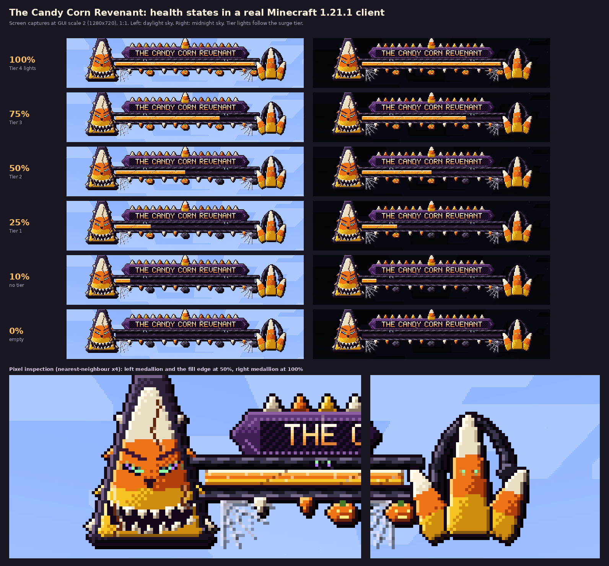
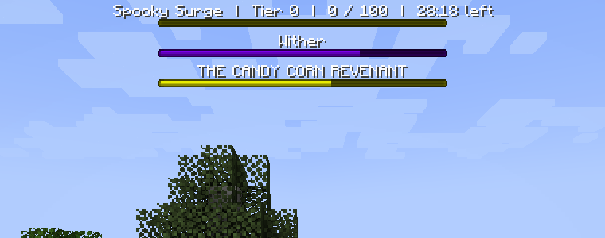

# The Candy Corn Revenant boss bar

A hand-drawn, animated-fill boss bar for Minecraft Java **1.21.1** (Fabric, Java 21, Polymer 0.9.19+1.21.1), built into this mod and
delivered through the server's Polymer resource pack. **No client mod.** It is the Spooky Surge's bar, and `RevenantBar` is a small
reusable class if another encounter should use it.



*Real captures from a 1.21.1 client (not a mock-up). A simulated compositing of the same files is in
[captures/health-states-simulated.png](captures/health-states-simulated.png).*

## 1. How it is rendered (verified against 1.21.1)

I read the client's `BossHealthOverlay` bytecode (Mojang mappings, the jar Loom builds against). What it does:

| Fact | Evidence |
|------|----------|
| The first bar's top is at y = 12 GUI px; each further bar is 19 px lower; drawing stops once `y >= guiHeight / 3`. | `bipush 12`, `bipush 10` + `bipush 9`, `guiHeight() / 3` |
| A bar is at x = `guiWidth / 2 - 91`, always 182 x 5. The fill is the progress sprite clipped to `lerpDiscrete(progress, 0, 182)` px. | `bipush 91`, `sipush 182`, `Mth.lerpDiscrete` |
| The title is drawn with `drawString` at x = `guiWidth / 2 - font.width(title) / 2`, y = bar top - 9, colour `0xFFFFFF`, **with drop shadow**, *after* the bar's sprites. | `Font.width`, `drawString(..., 16777215)` |
| Sprites are `minecraft:boss_bar/<colour>_background` and `_progress`, i.e. `assets/minecraft/textures/gui/sprites/boss_bar/*.png` (the GUI sprite atlas, not the old 1.19 `bars.png` sheet). | the `ldc "boss_bar/yellow_background"` constants |
| Raising a texture's resolution does **not** enlarge the bar: the sprite is always blitted into 182 x 5. | `blitSprite(sprite, 182, 5, ...)` |

**Option A (native sprites only)** gives a 5 px strip: reliable, but it cannot hold an ornament. **Option B (font glyphs in the title)**
can carry large art, and it works on an unmodified client, so the bar uses **both**:

* the vanilla bar still draws the **fill** (native clipping, native animation), using replaced `YELLOW` sprites;
* a **frame** (two font glyphs, 262 x 56 together) is drawn *over* it with a transparent 182 x 5 window exactly on the bar. Nothing important
  is ever clipped by the fill, because the face, the cluster and the rails are stationary frame pixels;
* the **name** is set in the pack's own pixel font (so its width is known to the server), and the four **tier lights** are small glowing
  glyphs overlaid on the unlit pumpkins baked into the frame.

No core shaders, no client mixins, no OptiFine/Iris.

### Why the bar is three rows

The art needs ~31 px above the bar and ~20 below, but a title can only sit one text row above its bar. So the server shows three vanilla
bars, in this order (the client stacks them in the order it receives them):

1. a `BLUE` **spacer** with an empty title (its sprites are fully transparent in the pack): pushes the next row down 19 px;
2. the `YELLOW` **art bar**: the real fill, and the title that carries all glyphs, top of the frame at y = 0;
3. a second `BLUE` spacer, so a boss bar from any other source starts below the ornaments instead of under them.

### Alignment (why it stays put at every GUI scale)

Both the bar and the title are centred on `guiWidth / 2`, using integer division. The title is built to be **exactly 262 px wide** whatever the
name is (the server places every glyph with `space` characters whose advance it knows), and the frame's window starts at x = 40 inside it, so
`guiWidth / 2 - 262 / 2 + 40 = guiWidth / 2 - 91` for any `guiWidth`, odd or even. The unit test `windowIsCentredOnTheTitle` pins the
constants; [captures/gui-scales-1-to-4.png](captures/gui-scales-1-to-4.png) shows GUI scales 1 to 4, including odd GUI widths (639 and 427).

### The drop shadow, used on purpose

Minecraft draws a title's shadow 1 px down and right, at a quarter of the glyph's colour. The frame uses this: its upper rope's shadow falls
on row 30 and becomes the top lip of the bar window, without touching a single bar pixel. Row 30 of the frame is therefore left empty.

## 2. Reserved colours: **YELLOW and BLUE**

A replacement boss-bar sprite applies to **every** boss bar of that colour on the server, from any mod, and for every player who has the pack.

* `YELLOW`: the art bar (candy-corn layered fill, drained plum cavity).
* `BLUE`: the invisible spacers.
* `PINK` stays with the World Boss (AscensionLib reskins it); `PURPLE` (vanilla Wither) and `RED` (raids), `GREEN`, `WHITE` and all notched
  overlays are untouched.

Before enabling this, check no other mod on the server uses `YELLOW` or `BLUE` boss bars. In this workspace's other repositories only `PINK`
is used. Anything that does use them will show the Revenant fill (YELLOW) or become invisible (BLUE).

## 3. The art

| File (in the jar and the pack) | Size | What |
|---|---|---|
| `assets/minecraft/textures/gui/sprites/boss_bar/yellow_background.png` | 182 x 5 | the drained cavity: dark plum, faint cracks |
| `.../yellow_progress.png` + `.mcmeta` | 182 x 80 (16 frames) | layered candy-corn cross-section (ivory crest, orange body, yellow base, burnt shadow), a seam every 26 px, a faint sheen walking along it |
| `.../blue_background.png`, `blue_progress.png` | 182 x 5 | fully transparent |
| `assets/spookysurge/textures/font/revenant/frame_l.png`, `frame_r.png` | 131 x 56 each | the frame, split in two (see limits) |
| `.../tier_lit.png` | 13 x 12 | a lit tier light |
| `.../letters.png` | 60 x 56 | the name font: A-Z, 0-9, `. , ' ! ? : - & /`, cell 5 x 14 |
| `assets/spookysurge/font/revenant.json` | | providers: three bitmap sets and a `space` provider (+-1 ... +-128) |

Palette: burnt orange, pumpkin orange, candy yellow, ivory tips, charcoal and near-black outlines, dark plum, with violet and sickly-green
accents on the eyes and the trapped eyes in the rope. The frame has a cracked, grinning candy-corn Revenant (carved brows, slit eyes, haunted
cracks) on a charcoal shield with candy-corn teeth, a smaller candy cluster inside a licorice hook on the other end, twisted licorice rope
rails with trapped spectral eyes, hanging candy-corn fangs, four carved jack-o'-lantern tier lights, cobwebs, and a cracked-enamel banner for
the name.

**Animation**: only the fill is animated (16 frames, `frametime 4`, a restrained moving sheen). That path is verified in a real client. The frame
is static on purpose. A low-health variant is not provided: the client cannot swap a texture per bar instance, so a variant would have to be a
second reserved colour.

Everything is drawn by code: `python3 tools/bossbar-art/build_assets.py` regenerates every PNG, the font JSON and the metrics file
byte-for-byte (seeded, no libraries beyond Pillow and numpy). Edit `tools/bossbar-art/revenant.py` to change the art.

## 4. Integration

Files: `com.spookysurge.hud.RevenantBar` (the bar), `RevenantTitle` (layout), `RevenantMetrics`, `RevenantPack` (pack registration),
`RevenantPreview` (operator preview). The surge uses it in `SurgeManager.refreshBar`:

```java
RevenantBar bar = new RevenantBar("SPOOKY SURGE", "Spooky Surge");   // name with the art, text without it
bar.setNames("SPOOKY SURGE 20/100", "Spooky Surge | Tier 1 | 20 / 100 | 24:10 left");
bar.setTier(1);                         // 0 to 4 lit pumpkins
bar.setHealth(current, max);            // or setProgress(0..1); NaN, negatives, zero max are safe
bar.addViewer(player);                  // idempotent; call every tick if you like
bar.removeViewer(player);
bar.close();                            // encounter over
```

* Server thread only. Names, tier and progress only produce a packet when the value changes (`ServerBossEvent` compares before it
  broadcasts; `addPlayer` only sends for a player not already in the set).
* `RevenantBar.registerHooks()` (called once) handles: the pack finishing or failing to load, disconnect, respawn, dimension change, server stop.
  A rejoining player cannot get a duplicate: viewers are keyed by UUID.
* The name: upper-cased, accents stripped, characters the font lacks are dropped, cut with `...` if wider than the banner (147 px, about 24 letters).

### Config and commands

* `bossBar` in `config/spookysurge/server.json`: `"auto"` (default), `"art"` or `"plain"`. See below.
* `/surge bar preview <percent 0-100> <tier 0-4> [name]` (op level 2): shows the bar to you for 60 seconds, in the mode your client would get.
  `/surge bar off` removes it.

## 5. Pack generation and delivery (Polymer)

Embedding the files in the jar does **not** deliver them. The mod registers them with Polymer (`PolymerResourcePackUtils.RESOURCE_PACK_CREATION_EVENT`,
`builder.addData(path, bytes)`, the same mechanism as the Candy Corn item, listing each file so the server-only metrics file stays out of the
pack). Then Polymer builds one pack for the whole server:

1. **Generate**: Polymer builds `polymer/resource_pack.zip` at startup, and `/polymer generate-pack` (permission level 3) rebuilds it. Check
   it contains the nine files above (`unzip -l polymer/resource_pack.zip | grep -E "boss_bar|revenant"`).
2. **Distribute**: use whatever the server already uses. With **`polymer-autohost`** (same version, `eu.pb4:polymer-autohost:0.9.19+1.21.1`) set
   `"enabled": true` in `config/polymer/auto-host.json`; it serves the pack on the game port, no second web server. Set
   `"required": true` (or call `markAsRequired()`) only if players must not be able to decline.
3. **Do not add a second hosting system.** If the pack is hosted some other way (for example `server.properties`), Polymer cannot see that the
   client loaded it, so `hasMainPack` stays false. Then set `"bossBar": "art"` and make sure that pack is required.

**Pack missing or declined**: with `bossBar: auto`, `PolymerResourcePackUtils.hasMainPack(player)` decides per player. Without the pack the
player gets one ordinary yellow bar with a readable text title (`Spooky Surge | Tier 1 | 20 / 100 | 24:10 left`): no spacer, no missing-glyph
boxes. If the pack finishes loading after the player joined, Polymer's `ON_RESOURCE_PACK_STATUS_CHANGE` event switches them to the art
(this path is coded but was not exercised, see the validation report). A client remembers a **declined** pack per server in `servers.dat`.



## 6. Limits, stated plainly

* **256 x 256 glyph limit.** Minecraft 1.21.1 bakes font glyphs into 256 x 256 atlas pages; a larger glyph renders as a missing-glyph box
  (this is why the 262 px frame is two 131 px glyphs; `RevenantAssetsTest` fails the build if any glyph PNG exceeds 256). A glyph is not
  scaled or clipped by the game, and its position is only as exact as the `space` arithmetic.
* **Ascent must not exceed height**, or the *whole* font fails to load; lowercase file names only. Both are tested.
* **Vertical room.** The first bar's top is fixed at y = 12, so the frame's top (y = 0) is the screen edge; bars from other mods are pushed below
  the third row. At large GUI scales on small windows vanilla stops drawing rows at `guiHeight / 3`, which can hide later rows.
* **Width.** 262 GUI px: it fits a 1280 px window up to GUI scale 4; at larger scales on small windows the ornaments run off the screen edges.
* The title is exactly 262 px wide only if the client has the pack; the fallback is a normal text title.
* The drop shadow is part of the look and cannot be turned off in 1.21.1.
* Only the fill animates; tier lights switch on, they do not pulse.
* The name font is uppercase only.

## 7. Testing

```bash
./gradlew build                                   # unit + asset tests, and the jar
unzip -l build/libs/SpookySurge-0.1.0.jar | grep -E "boss_bar|revenant"
```

In game (operator): `/surge bar preview 100 4`, then `50 2`, `0 0`, with a long name `/surge bar preview 60 3 A name that is far too long for the banner`.
Run a real surge with `/surge start 0`, `/surge add 20`, `/surge tier 3`. To look at the art on a plain vanilla server use the
[preview pack](revenant-preview-pack.zip) and [demo_commands.txt](demo_commands.txt) (`/bossbar` only).
`tools/bossbar-art/capture_states.py` and `real_sheet.py` produce the captures above from a running test client.
The full list of what was and was not verified is in [VALIDATION.md](VALIDATION.md).
