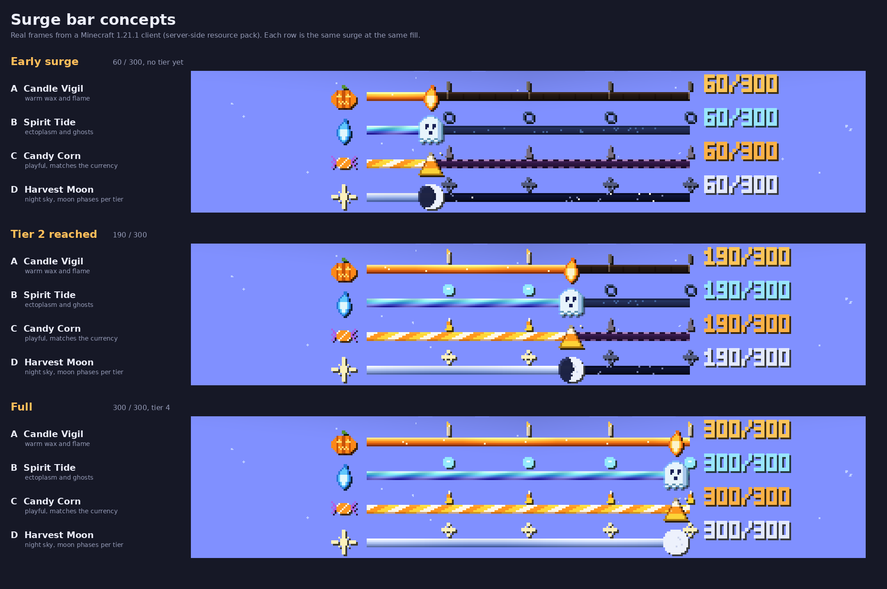
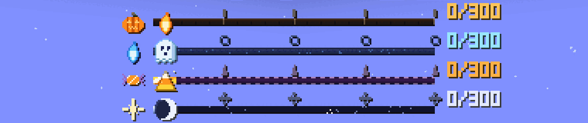

# Surge bar concepts

Exploration only: nothing in the mod uses these yet. The renders are real frames from a Minecraft 1.21.1 client
with a server-side resource pack, driven with vanilla `/bossbar` commands. `concepts.py` draws the art and builds
the title layout the server would send (`PACK=<dir> python3 concepts.py`, needs Pillow).

| | Colour | Look |
|---|---|---|
| A Candle Vigil | YELLOW | Wood rail with candle posts, glowing wax fill with embers, a flickering flame on the fill edge, pumpkin emblem. |
| B Spirit Tide | BLUE | Frosted glass, flowing ectoplasm, a bobbing ghost on the fill edge, soul-flame emblem. |
| C Candy Corn | GREEN | Stitched trick-or-treat bag, sliding candy-corn stripes, a sparkling candy corn on the fill edge. Matches the currency. |
| D Harvest Moon | WHITE | Twinkling night sky, moonlight fill, a moon whose phase grows with the tier. |

## What was verified in a real client

- Replacing a colour's bar sprites works, and a sprite can be animated with a `.mcmeta` (the fill and rail animate in the client).
- A custom font can put art in the title, placed to the pixel with `space` glyphs, so a glyph rides the front edge of the fill
  (checked at several fill levels). Emblem, tier pips, head glyph and counter digits all come from the title.
- Resource-pack names must be lowercase (`a-z 0-9 / . _ -`). A single bad name makes the whole font fail, and every glyph shows as an empty box.

## Constraints

- The bar sprite is 182 x 5 GUI pixels, so detail lives in the glyphs, not the bar.
- A colour's sprites restyle every boss bar of that colour on the server. CobbleRaids uses PINK (NOTCHED_20, reskinned by
  AscensionLib), the current surge bar uses PURPLE (vanilla's Wither too). Pick a colour nothing else uses; the notched
  overlays are shared by every colour.
- Players without the resource pack see empty boxes where the glyphs are. Polymer has `PolymerResourcePackUtils.hasMainPack(player)`,
  so the server can show them a plain bar, or `markAsRequired()` can make the pack mandatory.
- Not tested: GUI scales other than 2, the fallback bar, tier-up flash effects, and Polymer's auto-host delivering the pack.
